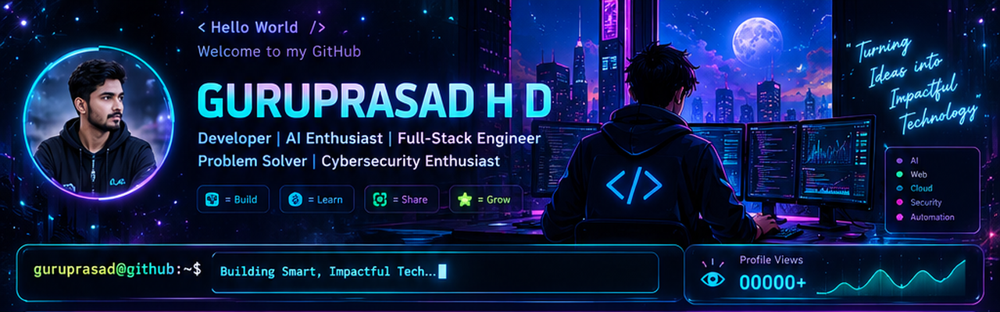

  
  
  

---

## `whoami` — About Me

I'm a Computer Science postgraduate at **University Visvesvaraya College of Engineering (UVCE)** who enjoys turning practical problems into useful software. My interests span AI-enabled applications, backend engineering, full-stack development, cloud-connected systems, and secure software.

- 🎓 **Education:** M.Tech in Computer Science and Engineering — UVCE
- 🧠 **Interests:** Applied AI, NLP, backend systems, full-stack development, cloud and IoT
- 🛠️ **Building with:** Java, Python, Spring Boot, Django, React, REST APIs and databases
- 🏆 **Hackathons:** IISF Hackathon Finals 2024; TechForSociety Finals 2025
- 🤝 **Open to:** Collaboration, open-source projects and software engineering opportunities

> *“Stay curious. Build boldly. Engineer for impact.”*

---

## 🚀 Featured Projects

<table>
<tr>
<td width="50%" valign="top">

### 🚄 Rail Madad AI
AI-assisted railway grievance portal exploring complaint categorization and text/image processing.

`Python` `Django` `NLP` `OCR`

[**View repository →**](https://github.com/GURUPRASAD178/RailMadadAI)

</td>
<td width="50%" valign="top">

### 📈 WealthManager
Full-stack portfolio analytics project for viewing holdings, allocation and investment performance.

`React` `Python` `Chart.js` `SQLite`

[**View repository →**](https://github.com/GURUPRASAD178/Wealth_Manager)

</td>
</tr>
<tr>
<td width="50%" valign="top">

### 🎁 TipEase
Cashless tipping application designed to make digital appreciation easier for service workers.

`Django` `Bootstrap` `Razorpay`

[**View repository →**](https://github.com/GURUPRASAD178/Tip_App)

</td>
<td width="50%" valign="top">

### ⚖️ LawBridge
Lawyer-client management portal with role-based workflows and appointment scheduling.

`Java` `Spring Boot` `Thymeleaf` `MySQL`

[**View repository →**](https://github.com/GURUPRASAD178/Law_Bridge)

</td>
</tr>
</table>

  

---

## ⚡ Tech Stack

  

<b>Explore skills by category</b>

- **Languages:** Java, Python, JavaScript, SQL, C++
- **Backend & APIs:** Spring Boot, Django, Django REST Framework, FastAPI, Node.js, Express
- **Frontend:** React, HTML, CSS, Bootstrap
- **Databases:** MySQL, SQLite, MongoDB
- **Cloud & tools:** AWS, Google Cloud, Docker, Linux, Git, GitHub, Postman
- **Data & AI:** NumPy, Pandas, NLP concepts, OCR and ML model integration

---

## 📊 GitHub Analytics

> Stats and language cards are provided by third-party services and may occasionally be unavailable or differ from GitHub's own totals.

---

## 🐍 Contribution Animation

Once you add the workflow in `.github/workflows/snake.yml` from the included setup bundle, this animated contribution graphic can appear here:

  <picture>
    <source media="(prefers-color-scheme: dark)" srcset="https://raw.githubusercontent.com/GURUPRASAD178/GURUPRASAD178/output/github-contribution-grid-snake-dark.svg">
    <source media="(prefers-color-scheme: light)" srcset="https://raw.githubusercontent.com/GURUPRASAD178/GURUPRASAD178/output/github-contribution-grid-snake.svg">
    
  </picture>

---

## 🔭 Current Direction

- 🧠 Build useful AI-powered workflows and NLP applications.
- ⚙️ Strengthen backend architecture, API design and database skills.
- ☁️ Explore cloud-connected systems, IoT telemetry and deployment automation.
- 🛡️ Deepen knowledge of networking, application security and system design.

---

## 🤝 Let's Connect

  
  
  

  Thanks for stopping by ✨ If a project interests you, explore it, share feedback, or let's build something meaningful.

