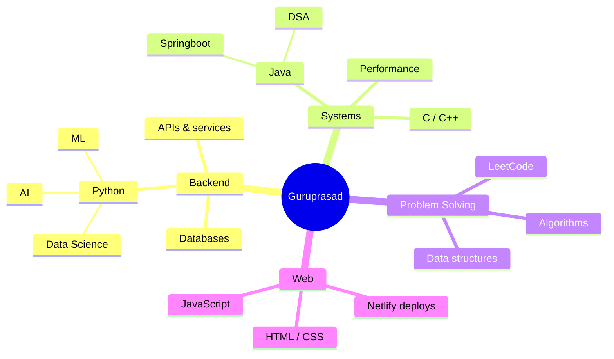

<!-- ═══════════════════════════════════════════════════════════════
     GURUPRASAD H D · GitHub Profile README  (v2)
     Put this in a PUBLIC repo named exactly: GURUPRASAD178
     Also add .github/workflows/snake.yml to activate the snake.
     ═══════════════════════════════════════════════════════════════ -->

<div align="center">


<a href="https://github.com/GURUPRASAD178">
  
</a>

<br/>


<br/><br/>

<a href="https://guruprasad-hd.netlify.app/"></a>
<a href="https://www.linkedin.com/in/guruprasad-h-d/"></a>
<a href="https://x.com/Guruprasad21891"></a>
<a href="https://leetcode.com/GURUPRASAD178/"></a>
<a href="https://www.instagram.com/royal_challenger_ka13"></a>

</div>

<br/>


## 💻 &nbsp;`~/guruprasad` — terminal

```console
guruprasad@uvce:~$ cat about.txt
Name       : Guruprasad H D
Status     : Computer Science Postgraduate @ UVCE
Location   : Bengaluru, Karnataka, India 🇮🇳
Focus      : Backend development · Systems programming
Languages  : Python · C++ · C · Cython · JavaScript · HTML · CSS
Practice   : Data structures & algorithms on LeetCode
Motto      : Build. Break. Learn. Repeat.

guruprasad@uvce:~$ git log --oneline --author="guruprasad" -3
a1f9c3e  ship: learning in public, one commit at a time
7be42d0  feat: explore backend & systems engineering
c03d8aa  init: curiosity enabled 🚀

guruprasad@uvce:~$ ./open_to --check
✔ Thoughtful software      ✔ New ideas
✔ Learning opportunities   ✔ Collaboration
```

<br/>


## 🧠 &nbsp;What I'm Focused On



<br/>


## 🛠️ &nbsp;Tech Arsenal

<div align="center">

<table>
<tr>
<td align="center" width="33%"><b>🔹 Languages</b><br/><br/>

</td>
<td align="center" width="33%"><b>🔹 Web</b><br/><br/>

</td>
<td align="center" width="33%"><b>🔹 Tools</b><br/><br/>

</td>
</tr>
</table>


</div>

<br/>


## 🚀 &nbsp;Featured Projects

<div align="center">

<a href="https://github.com/GURUPRASAD178/Law_Bridge">
  
</a>
<a href="https://github.com/GURUPRASAD178/Rail_Madad_2.0">
  
</a>
<a href="https://github.com/GURUPRASAD178/Tech_For_Society">
  
</a>
<a href="https://github.com/GURUPRASAD178/Tip_App">
  
</a>

<br/>

| ⚖️ **Law_Bridge** | 🚆 **Rail_Madad_2.0** | 🌱 **Tech_For_Society** | 💡 **Tip_App** |
|:---:|:---:|:---:|:---:|
| Web project bridging people and legal information | A fresh take on the Rail Madad passenger-assistance idea | Technology applied to social good | Quick tip and bill calculator |
| `HTML` `CSS` `JS` | `HTML` `CSS` `JS` | `HTML` `CSS` `JS` | `HTML` `CSS` `JS` |

<a href="https://github.com/GURUPRASAD178?tab=repositories"></a>

</div>

<br/>


## 📊 &nbsp;GitHub Analytics

<div align="center">


<br/>


<br/>


<br/>


</div>

<br/>


## 🏆 &nbsp;Trophies & Achievements

<div align="center">


<br/><br/>


</div>

<br/>


## 🐍 &nbsp;Contribution Snake

<div align="center">

<picture>
  <source media="(prefers-color-scheme: dark)" srcset="https://raw.githubusercontent.com/GURUPRASAD178/GURUPRASAD178/output/github-snake-dark.svg"/>
  <source media="(prefers-color-scheme: light)" srcset="https://raw.githubusercontent.com/GURUPRASAD178/GURUPRASAD178/output/github-snake.svg"/>
  
</picture>

</div>

<br/>

<details>
<summary><b>🎯 My 2026 goals (click to expand)</b></summary>
<br/>

- [x] Build and publish projects in public
- [x] Earn my first GitHub achievements
- [ ] Go deeper into backend and systems engineering
- [ ] Keep up a steady LeetCode practice
- [ ] Contribute to open source

</details>

<details>
<summary><b>⚡ Fun facts</b></summary>
<br/>

- 🎓 Studying Computer Science at **UVCE**, one of Bengaluru's well-known engineering colleges
- 🐍 Python is my go-to, C++ is where I go for speed
- 🧪 I like turning small ideas into working projects

</details>

<br/>


## 🤝 &nbsp;Let's Connect

<div align="center">

Interested in thoughtful software, new ideas, and chances to learn and build.
**Say hello!** 👇

<a href="https://www.linkedin.com/in/guruprasad-h-d/"></a>
<a href="https://guruprasad-hd.netlify.app/"></a>
<a href="https://x.com/Guruprasad21891"></a>

<br/><br/>


<br/>


</div>
